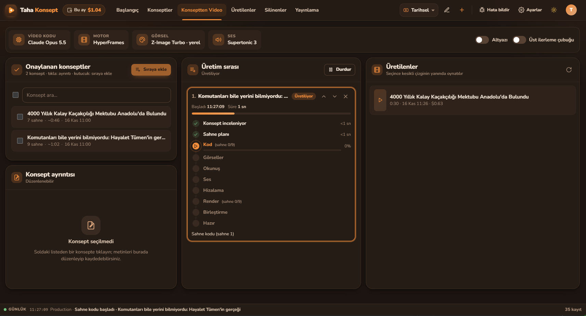
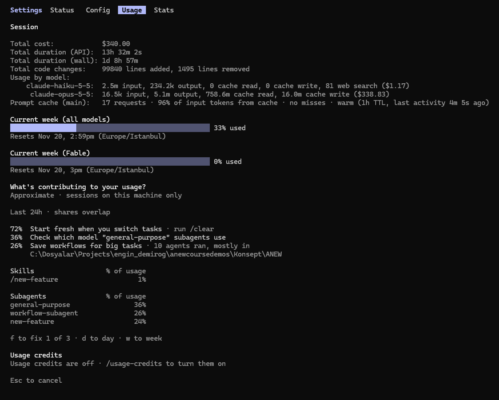
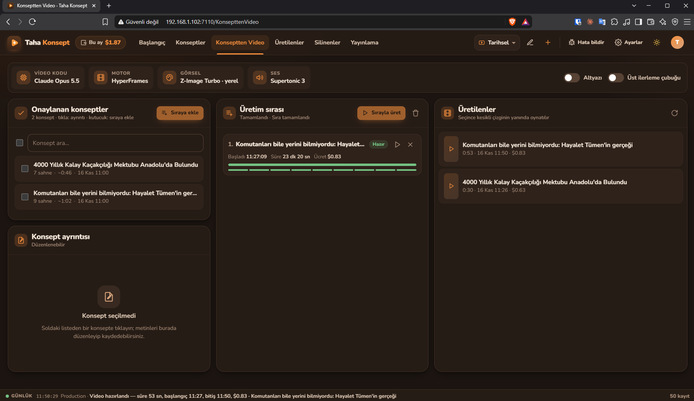
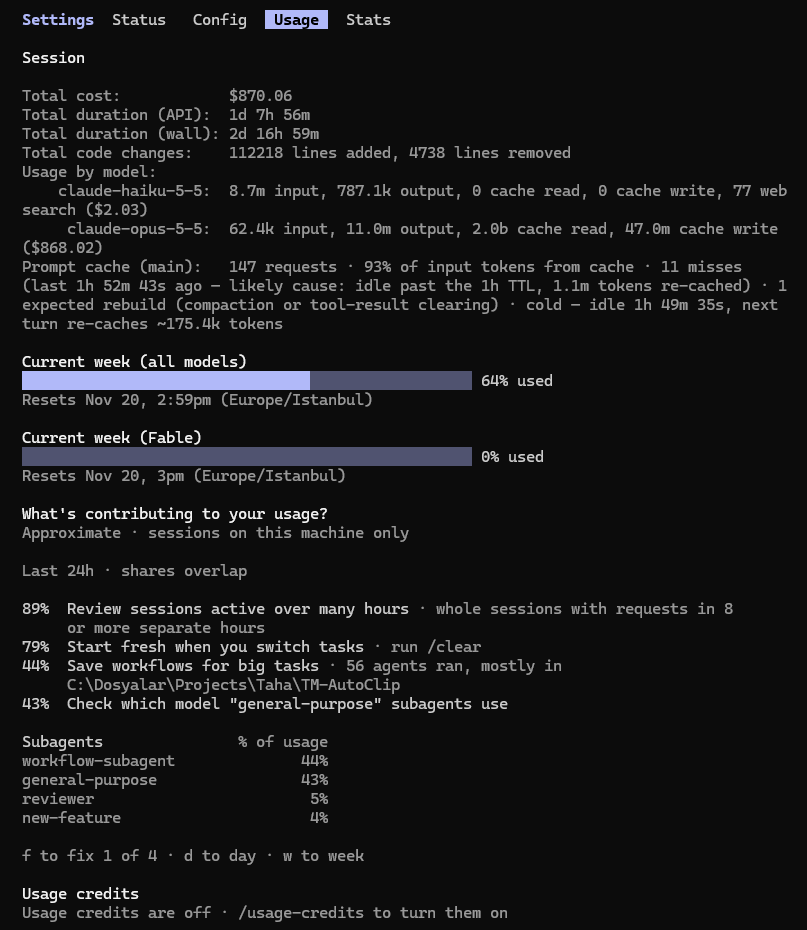

# Saf Claude ve ANEW karşılaştırması

Tam saf Claude çalışması olmadı fakat yinede fikir vermesi açısından verilerle paylaştım. ANEW Eğitimi 1. Hafta sonrası çalışması. ANEW bilgim burada 1. hafta ile sınırlıdır.

 
Taha ilk promt

Şimdi seninle bir tane program yazacağız. Programımızın adı Taha Concept olacak. Şimdi bazı kurallarımız olacak. Önce kurallarımızdan bahsedeyim. Kurallarımız birincisi bütün şu anki dahil olmak üzere promptlar adı altında açılan bir klasörün içinde kaydedilecek. Kaydetme konusunu sana bırakıyorum. Yani promptlar klasörünün içine örnek veriyorum her isteğime karşılık cevaplarını da kaydedeceksin. Mesela ben sana şu an böyle çok uzun bir yazı yazdım ya, bu uzun yazıyı kaydedeceksin. İşte istek eşittir bu uzun yazı. Cevap sonrasında bana vereceğin cevap. Örnek veriyorum işte konuşuyoruzdur. İşte tek cümlelik bir şey yazmışımdır. İşte tartışalım demişimdir. Sorular sorursun. Şıklı olabilir, şıksız olabilir. Hiç fark etmez. Kısacası bütün promptlarımızı kaydedeceğiz. Mümkünse zaman çizelgeli olarak kaydedelim. Sıralı kaydedelim. Mümkünse değil bu arada. Yani zaman çizelgeli ve sıralı kaydedeceğiz. Ben sonrasında bunları incelemek istiyorum. Sorduğum ve verdiğin cevapları kaydetmek istiyorum. Kendine düşündüğün yazıları yazmana gerek olmayabilir. Ama hani bana direkt sorduğun verdiğin cevaplar kayıt olacak ve şu anki bu promptla başlayacak bu iş.

İkinci kısma gelirsek, sesten yazıya çevirme üzerinden sana yazı yazıyorum. Yani bunları klavyeden yazmıyorum. O yüzden sesli konuşup da yazıya çevirdiğim için arada minik kelime farkları olabilir. Bunları yakalayabilirsin diye düşünüyorum. Yine zaten Claude'un web sürümünden bunu yaptığım için muhtemelen çok bir sıkıntı yaşamayız. Ama yine de aklında bulunsun.

Commit kısmına gelirsek de şöyle commit'i burada almayacaksın. Sen şu an çalıştığın dizinden değil, çalıştığın dizinin iki üst dizini olan anewcoursedemos Adlı klasör üzerinden commit alacaksın. Commit'leri pushlamayacaksın çünkü daha ben pushlamadım. Sadece commit alacaksın. Commit alırken çok nadir bir sorun çıkabilir. Çünkü seninle beraber başka klasörlerde de aynı anda farklı çalışmalar yürütülüyor. O yüzden iki kişi aynı anda commit almaya çalışabilir. O yüzden ona dikkat et. Commit alırken sadece kendi klasörünün commit'ini alacaksın. Sadece kendi klasöründen commit almak için 200 klasöre gideceksin. Onun dışında bütün çalışmalar kendi klasöründe olacak.

Onun dışında senle 3 tane daha klasör açacağız. Bir tanesi source klasörü. Bu klasörün içinde işte sen mesela birazdan sana programı tanıtacağım ve isteklerimden bir tanesi de program için bana bir tane Cloud Web üzerinden üretebileceğim ikon promptu olacak. Bana bir tane prompt vereceksin. Ben bunu Cloud Web'e vereceğim. Orada onun da ben ikon üreteceğim sen çalışırken. Sonra ikonu bulduğum zaman ikonu beğenip indirdiğim zaman source'un içine koyacağız. Source'un içinden kullanacaksın projenin içinde. Yani oradan alacaksın. Source ad üzerinde kaynaklar, işte resimler, videolar vesaire bütün her şey orada olacak. İkinci klasörümüz memory klasörü olacak. Memory klasörünün içine memory yönetimi yapacaksın. Mesela şu an seninle ilgili projenin temellerini atıyoruz ya. Bu attığımız temeller, aldığımız kararlar mesela kesin kurallarımız olacak. İşte sana ileride diyeceğim ki şu yasak, bunu bir daha yapma. Bunların hepsini buraya not alacaksın ve bütün bu kurallar uygulanacak. Kendi Cloud MD'nin içine yazsam bile yani sonuç olarak burada kural yapısı oluşturacağız. Ben bu kurallara müdahale edebileceğim. Kurallar kategorili olabilir. İşte örnek veriyorum işte şu sayfa için kurallar ya da kod için kurallar, tasarım için kurallar gibisinden. Ayırabilirsin. Hepsini tek dewe tutabilirsin. Kısa öz kendine notlar alacaksın. Sana bir daha böyle yapma dediğimde ya da gerçekten kızdığım zamanlarda hani bunu anlarsın zaten. Yani kızmasam bile uyardığım zaman buraya otomatik olarak kuralları ekleyeceksin ve bu kuralları dikkate alacaksın tabii ki de. Yani bu kurallar altında ilerleyeceğiz. Hem sen kendin yazacaksın ve kendi yazdığın kurallara uyacaksın. Diğer klasörümüz de raporlar klasörü olacak. Raporlar klasörünün içine sana mesela araştırma yaptıracağım. Şu konu hakkında internette araştır, nasıl yapabiliriz diyeceğim ve internette araştırdıktan sonra bizim program için işte araştırma olacak doğal olarak. Bizim program için bulduğun araştırmaların raporlarını buraya hazırlayacaksın. Raporlar da iki türlü olacak. Birincisi raporları daha sonra ileride uzun zaman sonra unuttuğunda kendin hatırlamak için hızlı bir .md formatı olacak. Bir de benim okuyup görmem için index.html halinde hani CSS'li bir web sayfası olacak şekilde olacak. İki format şeklinde üreteceksin raporları da. Ve bu da işte kural kısmına bir örnek. Mesela en basitinden rapor oluşturma kuralı. Rapor istendiği zaman hem kendi anlayacağım .md hem de index.html olacak yani. Gibisinden düşünebilirsin raporları memory yani memory kısmında, hafıza kısmında. Bu arada hafıza kısmında sadece kural olmayacak. Yani tasarım ipuçları, kendine aldığı notlar her şey olabilir. Orası sende ama oraya notlarını alacaksın. Yani havada kalmayacak hiçbir kararımız.

Projemizde web olarak, web'in sunucusu olarak Raspberry Pi'yi kullanacağız. Lokalde bağlı olan Raspberry Pi'yi. Raspberry Pi 5 8 GB. O yüzden 8 GB RAM'e sahip. RAM her türlü yeter. Yani ihtiyaçlarını karşılar şu anki isteğimiz için diye düşünüyorum. Bağlantı bilgileri anewcoursedemos içindeki .env dosyasının içinde. Oradan Raspberry Pi bağlantı bilgilerini alabilirsin. Sunucu kısmında Raspberry Pi kullanacağız. O yüzden açtığın port aralıkları da var içinde. Hani kullanılan port aralıkları. Boşta bir port alırsın.

Şimdi yavaştan kod kısmına geçersek, kodlamada mimarimiz modüler monolit ama her modül de kendi içinde clean architecture olacak. Ve kodlama yapımızda çıplak bir class kalmayacak. Şöyle ki çıplak class kalmayacak. Interface, abstract ve class yapısı olacak. Bu yapıyı da şöyle açıklayabiliriz. Örnek veriyorum. Bir tane mesela şimdi projenin içinde de olacak. Modeller olacak. LLM modelleri. LLM modellerin her birinin farklı özelliği ya da farklı bağlantısı olabilir. Her biri için aynı değerleri alan farklı farklı klaslar açmaktansa işi şu hale getiriyoruz. Bir tane interface oluyor. Orada değerleri tanımlıyorsun öncelikle. Interface'in içinde değerleri şöyle tanımlıyorsun. Online modeller olacağı için öncelikle içinde bir tane platform adı olacak. İşte OpenAI mi, OpenRoad mu, Claude mu, yani Anthropic mi? Ondan sonrasında bir tane de tabii onu abstract'ın içine koyuyorsun. Sonrasında bu abstract'a referans veriyor, miras veriyor. Abstract'ın içinde bu değerler oluyor. Bir tane de RAM metodu oluyor. Interface'in içinde tabii şeyler de olacak. Bağlantı bilgileri işte URL, API gibi değerler olacak. Abstract'ın içinde de bir tane generic, işte prompt belli oluyor zaten RAM'da başında. Metot örnek veriyorum string prompt diye bir şey olur. Onu alır. Sistem prompt olur. Run diye bir şey olur ve cevabı döndürür. Generic. Bu süreçten sonrasında sen o abstract metottan miras aldığın class üretirsin. İşte OpenAI üzerine üzerine. Hatta bazı LLM'ler sadece text, bazıları resim oluyor. Resimde farklı şeyler oluyor. Cevabı farklı alıyorsun falan. Onlar da ayrı interface'ler dallanır. Dallanan interface'lerin abstract'ları olur. O abstract'ların class'ları olur ama düzgün bir mimari kuracağız. Interface yapısını kullanacağız. Bu ne işe yarayacak? Bizim kurduğumuz sistem bir algoritmik tasarım olacağı için biz interface'ler üzerinden çalışacağımız için o interface'i miras olan her class bu sisteme dahil olabilecek. Bu sayede sistem çok rahat genişletilebilir ve gelişebilir olacak. Ayrıca biz interface'lerin çalışmasıyla ilgilendiğimiz için class'ları ekledikten sonra sisteme sadece entegre etmesi kalıyor. Class'ların çalışıp testlerini yapmamıza çok fazla gerek kalmıyor. Tabii ki de test edeceğiz de. O yüzden buna dikkat edelim. Interface, abstract ve class yapıları olacak. O yüzden de bunları böyle kurmanı istiyorum. Her bir kısım için kendi içinde işte abstract klasör olur, soyut klasör. İçinde interfacer olur, base klasör olur, içinde abstract class'lar olur. Bir de concrete olur, içinde de normal class'larımız olur. Gibisinden bir klasör yapısı tercih edersen benim işime gelir. Çünkü hepsi bir arada şey olur. Ondan sonrasında en kritik kısmımız böyle bir dosyanın içine 5-10 tane nesne koyuyorsun. Yani nesne dediğim hani interface, abstract, class, inam fark etmeksizin hani türlerin hepsinin genel adı nesne olduğu için çoklu nesne oluyor. Bu yasak. Bir dosyada bir nesne olabilir. Mesela bu yasak dedim ya, şu an bunu alacaksın, artık kurallar kısmına yazacaksın. Hangi kısmına yazdım beni ilgilenmez ama kuralları yazacaksın ve bunu okuyacaksın ve uyuyacaksın. Bir dosyada birden fazla şey olması yasak. Nesne olması yasak. Çok fazla dosya olabilir. Sorun değil. Ama her dosyada bir nesne olacak. Öyle gidip de controller'ın altına sadece orada kullanıyoruz diye class eklenmeyecek. Class'ların yerleri olacak. Her bir class, yani class'ın inamın falan yeri olacak. Controller içinde iş yok. Controller gelen veriyi alır, bakar düzgün mü diye, yani valid mi diye. Fluent validation varsa tek satırlık bir fluent validation kontrolü yapabilirsin. Generic metotlarla halloluyor. Kontrol yaptın, valid. O zaman servise atarsın. Servis katmanında bu iş yapılır. Gelen cevap direkt döndürülür. Controller'da öyle bir satırdan fazla iş yok. Başka bir sürü daha kodlama metodum yani kuralım olacak ama hem şu an bir anda doğaçlama yapınca aklıma gelmedi. Hem de geç saat olunca benim de yoruldum tabii. O yüzden onları sonra yaptıkça da düzenleriz. Ve summary alacak. Yani her bir class, nesne, interface'in başında summary olacak. Bu summary'lerin içindeki önemli metotları anlattı ya da önemli değişkenleri anlattı ve class'ın kendi genel olarak ne iş yaptığını anlattı. Bizim anlamamız kadar çok senin de kendini anlayacağın şekilde summary'ler lazım. Neden? İşte karışıklık oldu, yanlış dosyaya girdin. Class'ı durduk yere işte 1000-2000 satırlık bir class'ı okumaktan en azından baştaki summary'ı okuyup işi çözebilirsin.

Tema alarak da turuncu bir tema hedefim var. Böyle turuncu, kahverengi tarzında böyle insanın biraz işini açacak. Ya aslında birazcık kahve dükkanı gibi olacak tema ama hiçbir alakası da yok bu arada o işle. Böyle bir tema hayalim var. Bir tane de koyu mod istiyorum. Hani açık tema dediğim gibi turuncu, beyazımsı turuncu ya da açık kahverengi, beyaz turuncu. Bunlar hani açık moda daha yakın olduğu için programın özü açık mod oluyor. Bir de bunun beyaz yani açık mod olacağı için bir de bunun koyu modu olacak. Açık ve koyu mod. Sağ üstte bir yere ekleyebiliriz. Güneş ve ay şeklinde oradan değiştirebilir.

Bütün değişikliklerde versiyonlama yapılacak. Versiyonlamada şöyle olacak. Mesela versiyon 1 yani V1 dediğimiz zaman bu programın tam testlerle çalışır hali olacak. Ondan öncesi yani biz o aşamaya şu an hemen gelemeyeceğiz. O yüzden biz 0.1.0'dan başlayacağız. Her ufak düzeltme, örnek veriyorum sana dedim ki işte sağ üstteki hata bildirde hata bıldır yazıyor. Hani i yerine ı yazıyor gibisinden onu düzelttirdim. Bunu düzelt, tekrardan işte Raspberry'e gönder, build et, execute build et, release et, Raspberry'e gönder dedim. Raspberry'e gönderdin. Örnek veriyorum işte göndermeden önce versiyon 0.1.0.1.20 ise 0.1.21 olacak. Ama mesela bir tane sayfada komple bir düzenleme yaptık ya da bir tane sayfa ekledik ya da bir tane sayfanın kapsamlı bir değişiklik oldu, örnek veriyorum model kısmında, o zaman 0.2'ye geçebilirsin. Hani ortadaki değeri arttırabilirsin ama onu da zırpırt arttırmamamız lazım. Çok bir hakkımız kalmıyor onda da. Zaten sana çoğu şeyi baştan bayağı hazır vereceğim için yani versiyon 0.1.10'da falan biz bu işi bitiririz diyorum.

Ve geldik o önemli ana, projenin konusuna. Projemizin adı Taha konsept, yani Taha benim adım olduğu için var. İşin özünde adı konsept. Konsept adı şöyle, bir kanal konsepti oluyor. Bu sosyal medya kanalı. YouTube bazında örnek alabiliriz ama sadece YouTube değil, bütün dikey platformlar ya da yatay platformlar için geçerli olacak. Projenin konusunda olay şu. Konsept adı altında konsept üreteceğiz. Şimdi konsept üretme derken konsept kısmı şu. Konsept üretme dediğimiz kısım bir video temasıdır. Yani video teması dediğim konseptin içinde ne olur? Konseptin içinde sahne başlıkları olur. Sahnede o sıra ekranda gösterilecek de olur. Sahnenin arkasında seslendirme yapan kişinin metni olur. Hani bu bütün tema, yani videonun kurgusundan şeyine kadar fikir kısmı konsepttir. O yüzden projenin adı da konsept ki temelimizde konsept zaten. Konsept üreteceğiz. Üretilen konseptlerden gidip bu konseptlerin detayı üretilecek. Detayı üretildikten sonra işte videosu üretilecek. Videosu üretilirken de seslendirme yapılacak. Bunların temel olayı da şöyle olacak. Bunların bütün yönetimi, işte API key'lerini girdiği yerler web sitesi üzerinden bizim sunucumuzdan yapılacak. Fakat minik bir tane de uygulamayı indirecek, bilgisayarına kuracak. Web sitesi üzerinden biz bu programla, kendi programımızla iletişime geçeceğiz. Bu program görev çubuğunda sağ altta gözükecek. Üzerine sağ tıkladığı zaman çıkış yapabilir ya da hesap değil de siteye git olur bir de. Siteye git diyerek hani bizim direkt web sitesinin açılmasını da sağlarız. Programın amacı şu olacak. Şimdi bir konsept üretimi. Konsept üretimi online modellerle gerçekleşecek. Bundan yana sıkıntı yok. 2. Konseptin videoya çevrilmesi. İş burada patlıyor. Konseptin videoya çevrilmesinde ben testleri Claude Code'la yapacağım. Claude'un yani Anthropic'in API'siyle yapacağım. Orada kredim var. Ama bunu tabii ki de sadece Anthropic'le kısıtlamayacağız. OpenAI olabilir, işte GLM olabilir, Kimi olabilir, hepsi de olabilir. Olay şu burada. Şimdi online'da konsept üretti yaptık. Tamam, videoya çevireceğiz. Şimdi videoya çevirmek istediğimiz zaman konsepti videoya çevirirken API'den bize şu cevaplar gelecek. Ekranda gösterilecek görüntünün render'ı. Ve bu render'ın aynı zamanda yani gösterilecek render görüntünün kodu. İşte Remotion olabilir, Hyperframes olabilir ki Hyperframes kullanırız. Bunun kodunu verecek. Şimdi bu kodu vermesi yetmiyor. Bu kodun işlenmesi lazım. Bu kodu işlemek için de kişinin bilgisayarına ihtiyacımız var. Artı seslendirme. API'den seslendirme gelmiyor. Seslendirmeyi de lokal LLM'lerden yap. Yani online LLM de kullanabilir. Orada o seçeneği de veririz. Ama seslendirme için de bir şey yapması lazım. Yine ollama ile lokaldeki LLM'lerden kullanması lazım. Bunda birkaç tane seçeneğimiz var elimizde. Bir de sürekli koddan da görüntü üretmek istemeyebiliriz. Bazen mesela benim şu an ekran kartımda VRAM 6 GB, onlar destekliyor. Mesela Zmesh Turbo Flux 2 Klein 4B modelleri lokalde çalışan bir model. Tabii yine online LLM verisi online LLM'le de ürettirebilir. İşte GLM ya da ChatGPT ile vesaire. Gerçekçi görsellerle desteklenen videolar da yapabiliriz. Yani bu desteklere de girebiliriz. Ondan sonrasında bir de seslendirme kısmı demiştik. Seslendirmede de Supertonic 3 var lokal için. Chatterbox Multilanguage var bildiğim kadarıyla. GPT-4o var bir de. Ama tabii yani online LLM desteği verelim ama pahalı bence o. Başka Türkçe için özellikle, yani Türkçe odaklı. Tabii bütün dilleri de kapsayacak şekilde. Ama sadece Türkçe için olanlar da olur. Sadece İngilizce için olanlar da olur. Yanlarına sadece Türkçe ya da sadece İngilizce deriz. Destekleyen seslendirme modelleri koyabilirsin ya da görüntü modelleri. Ama video kod üretimi, konsept üretimi, bunların hepsi online LLM'le olacak. Bunlar lokaldeki LLM'lerin yapabileceğini düşündüğüm şeyler değil. Ve konsept programının yanına bir de yayınlama ekleyeceğiz. O da ikinci kısım olacak. Yani böyle kısım kısım gideceğiz. Zaten bir plan yapacağız seninle şimdi. O plan dahilinde ilerleyeceğiz.

Öncelikle proje klasörünün bir üst klasörüne çıkarsan, yani konsept klasörüne gelirsen, burada bir source klasörü var. Bunun içine girdiğimiz zaman sources klasörü var. Bunun içine girdiğiniz zaman 3 tane PNG var. Bunlardan konsept sayfası tasarım adlı bir resim var. Bu resimde sana zaten kafamdaki tasarımı anlattım. Sol üstte logo ve programın adı olacak. Hemen yanında aylık harcama olacak. Böyle bu ay işte $2 harcadığınız gibi. Sentleri de, kuruşları da söyleyelim. Sonra sağında sayfalarımız olacak. İşte aylık harcama, konseptler sayfası, konseptten video sayfası, üretilenler sayfası, silinenler, profil. Şöyle ki silinenlerin sağında da yayınlama adlı bir sayfa daha ekleyeceğiz. Orada da üretilen videolar için yayınlama süresi eklenecek. İşte adam videosunu kendi bilgisayarında işte onun bilgilerini kullanarak ürettik, izledi, beğendikten sonra dedi ki işte ben bunu yayınlayacağım. Şimdi yayınlama için de adama destek sunmak lazım. Ondan sonra sağ üst tarafta da ayarlar, yanında hata bildirimi, yanında bir tane artı ikonu, bu profil eklemeyi sağlayacak. Solunda da profil seçimi. Profil dediğimiz kısımda konsept profiller, yani adamın mesela bir tane değil 3 tane kanalı vardır. Biri tarihtir, biri teknolojidir, biri şeydir, futboldur mesela. Üçüne de buradan videolar üretiyordur mesela. O hakkında şeyler. Ve bu üst taraf projenin her birine genel olacağı için diğerlerini de anlatmadım. Sonrasında hemen altında bir tane model bilgisi kısmı var. Burada işte model bilgisi, sağında örnek veriyorum. İşte konsept için Claude Sonnet 5.5 High var. Anlam yakalamayı işte multilanguage mini LLM'le yaptık. Konuyu da Claude Haiku 5.5 ile yaptık high performans'ta. Buraya tıklayınca ama hani bu bilgi kısmına tıklayınca altta konsept üretimi, anlamca tekrar denetimi ve konu önerisi açılır kısımda gözükecek. Ama açılır kısımda aşağıya sıkıştırmayacak. Ekranın üstünde ayrı bir modal olarak çıkacak. Buradan tekrar seçimler yapıp ekranın herhangi bir yerine ya da kapat tuşuna basarak ayarları güncelleyebilir. Onun hemen sağ tarafında ince ayar bilgisi olacak. Ekranın sağ yarısında. Orada da ince ayar bilgisine tıkladığı zaman ton, izleyici ve anlatım biçimi seçimleri yapabilecek. İşte gizemli, eğitici, dramatik, sakin, belgesel, esprili, ilham verici ve sorgulayıcı tonları. İzleyici kısmında işte konuya yeni başlayan, meraklı, aile ve çocuklara uygun ve konuyu bilen diye. Anlatım biçiminde işte tek bir hikaye, sıralı liste, efsane mi, gerçek mi, ya olsaydı gibi çeşitli internet konuları. Onun hemen sağında da kelime denetimi diye bir checkbox olacak. Bu checkbox kelime denetimi şu, yani kelimelerde tekrar eden var mı? Konsept üretiminde hani çok sık kelime tekrar ettiyse hani bunu tekrar üret, kelime tekrar var diyebiliyor. Çok sık rastlanan bir durum değil de işi garantiye alalım diye. Ondan sonra konudan üretme var. Bir de fikirden üretme var. Şimdi konudan üretme şu. Haiku 5.5 ile işte 1 ile 100 arası bir seçimle konu üret diyebiliriz. Konu üret dediğimiz zaman bizim ekrana Haiku 5.5 konu üretecek. Tabii bunun arka planda biz otomatik bir sistem promptu yapacağız. Yani daha önceden üretilenler tekrar üretilemez. Daha önceden videosu yapılmış ya da beğenilmemiş, hani seçilmemişler, beğenilmemişler. Bunlar tekrardan üretilemez. Yani buna göre de arkada sistem promptunu çok token yemeyecek şekilde optimize ederek hani şu konular elendi, şu konular seçildi gibisinden bir odak noktasına da çekebiliriz işi. Performansı arttırmak için. Ayarlar kısmına da buna özel tabii ki de öneriyi sıfırla gibi bir şey koyarız. Durumu anlatırız hani bunlar sıfırlanacak diye belki sıfırlamak da isteyebilirler de. Ondan sonrasında solda konu üret diye Haiku bize verdiği konulardan seçtiklerini üret dediğimizde, yani o sadece başlık olarak biliyor zaten, üreterek söylemiyor masraftan kısmak için. Konu üret kısmı öyle olacak. Sadece başlık üretecek. Örnek veriyorum işte Vikinglerin Ayasofya seferi diye. Bu bir kalıp. Üret dediğim zaman detaylandıracak, işte sahneyi falan, tasarımını hesaplayacak. Gerçekten konuyu araştıracak. Bu arada hani mesela tarih dedi ya da şey dedi ya, bunlarda uydurma yapacağız. Hani gerçekten gerçek verilerle geleceğiz. Spor da olabilir, yani gerçek anlatacağız. Seçtiklerini üret dedi. Üretilenler sol alttaki üretilenler kısmına gidiyor. Bir de sağ üstteki fikirden üreterek kısmı var. Fikirden üreterek kısmında ise sen yazıyorsun işte Osmanlı ile alakalı, Osmanlı'nın kuruluş aşamalarıyla alakalı, işte ilk 3 padişahı kapsayan, onların savaş zaferlerini anlatan, işte kudretli şekilde savaş anlatan, ilham veren bu tarzda şeyler istiyorum diyorsun ve yine orada da altta bir konsept sayısı var. Yine 1 ile 100 arası değişen, bu kadar da bu şey istiyorum diyorsun. Üret dediği zaman da oradan da sana yine üretilenlere gidiyor. Burada fark şu, orada sadece başlık üretip hani seçtirtmiyor. Doğrudan fikirde şey üretilenler kısmına gidiyor. Burada bir de şey var. Ee, Üretilenleri düzenleme alanı var. Üretilenlerde seçtiğin zaman işte sağında kalem ikonu düzenle. Sağ tarafta. Hemen onun bir sağında da işte çöp kutusu ikonu kırmızı klasik. İşte sil gibisinden. Mesela üretti. Okuyorsun. Yine aynı örnek. Vikinglerin Ayasofya seferi. İşte bildiğim bir hikayede başkasından görmüşsündür. Yani bir terslik vardı ya bir şey düzelteceksindir. Hani şurayı düzelt diye. Ya da işte hukuki açıdan sıkıntı olacak bir şey fark etmişsindir. Ya da ileride dert olabilecek bir şey. Düzeltmek istiyorsundur. Orada düzenle butonu var. Ona tıkladığı anda sağ alttaki alanda orası açılır. İşte sahne tasarımları, metinleri görürsün. Orada doğrudan metinlere müdahale edebilirsin. Ya da altta çıkan bir alan olur. Oraya fikrini yazarsın. İşte şu kısımları düzelterek tekrardan üret dersin. O tekrardan eleleme gider. Online eleleme. Düzeltilir. Düzeltilmiş haliyle tekrar gelir ve tekrar okuma imkanı olur. Burada fark şu. Adam yapılan düzenlemeyi beğenmediyse geriye gelmesi gerekir. Burada çok fazla teknik bir konuya girmek istemediğimiz için yani çok fazla bir arka plana da girmek istemediğimiz için bu işi de şöyle çözeriz. Düzenlenmiş olan hali ya ekranda ayrı bir modal çıkar, onaylarsa yerini alır, onaylamazsa silinir. Daha doğrusu onaylamazsa değil, yani ekranda ek bir modal açılır. Sayfayla alakasız direkt ekranın üstüne ayrı bir modal açılır. Yeni gelen orada gösterilir. Bunu seçiyorum. Bunu sil ya da bunu da düzenle. Yani bunu da düzenle deyince orada bir döngüye girer artık. Yani yine fikriyle beraber ya da değiştirerek eleleme gider. Elelemden gelen cevap tekrar ekranda ek modal açılır. Ta ki onaylayana kadar ya da silene kadar. Böyle çözebiliriz bence bu işi.

Şimdi diğer sayfaya geçersek konseptten video sayfasına. Üst tarafı dediğim gibi hani zaten öncekiyle aynı olacağı için tekrardan orayı anlatmayacağım. Orayı da çizmedim. Sağ üstte sadece biraz önceki sayfadaki kelime denetim seçimi kısmında altyazı var ya da yok seçimi olacak. Bu da üretilen videolarda, AI videolarda genelde altyazı olur işte. Okunan kısım ekranda altyazıda hatta rengi falan değişir. Bunu istemeyebilir ya da isteyebilir. Bir de şey kısmı var. Son dönemde çok moda oldu. Onu da ekleyelim oraya. Şimdi aklıma geldi. Tema olarak üstte böyle zaman çizelgesi falan akıyor. Yani böyle loading bar gibi hani bitene kadar süre üstte akıyor. Sürenin ne zaman biteceğini bilmesi izlenmeyi düşüren bir şey. Bu yanlış. Mesela bunun ama olmasını isteyebilir de. Yanlış ama olmasını da isteyebilir. Onu koyalım. Yani herhangi bir ekranda öyle bir şey istiyorum diye. Bu arada bunların gerçekten çalışması lazım. Hani tiki seçince çalışmazsa bir anlamı yok. Model seçimi kısmında yine aynı şekilde burada da modellerimiz olacak. Şöyle ki video kodu için öncelikle kodlamayı ne yapsın? Mesela bu kodlamada da Opus daha iyi. Tabii ki de yanında performans seçimi işte low mu max, low'dan max'a kadar. ChatGPT seçerse işte onun şeyi için seçimleri, performans, efor seçimi. Bir de video motoru var. Video motorunda hyperframes varsayılan Remotion ve Revideo olsun. Başka önerdiğin varsa araştırırsın bu arada bunları yine bir bakarsın önce bir başka bir alternatifler var mı diye onları da eklersin. Değiştirmeyelim de. Görseller kısmı yine aynı şekilde Z-Image, Flux 2Clay'in ondan sonra kapalı da olabilir bu arada. Yani koddan çizebilir. Sadece koddan çiz diyebiliriz. Onun dışında işte Nana Banana, Fal AI'daki şeyler, modeller falan. Yine seslendirmeyi biraz önce söylemiştim. Chatterbox, Supersonic ya da kapalı sessiz video da olabilir belki. İstemeyebilir. Onun dışında şu an model kısmı bu şekilde. Sonra onaylanan konsept listesi. Onaylanan konsept listesi şu. Bir önceki sayfadaki onaylananlar otomatik buraya gelir. Buradan da seçilenler üretim sırasına geçer. Üretim sırasına seçilenler geçerken tabii ki de tıklayacağız. Yani tike basıp da geçireceğiz. Ama sadece o işte onaylanan konsept listesinden bir tanesine tıkladığında da hemen alt kısımda ayrıntılar açılır. Belki hani sonradan konseptten vazgeçti. Ya bunu şöyle düşün. Mesela 3 tane olursa zaten aklında kalır ama belki 100 ekledi, 250 tane koydu buraya. Mesela bir seneyi tekte çıkartacak. Ben örnek veriyorum. Ya çünkü bende mesela şu an $200 API var. Abonelikten dolayı gelen hak. Hani hediye. Mesela ben bu $200'dan ortalama $1'a bir video üretiyorum. 200 taneyi tekte ürettim mesela. Yapabilirim. Seçilenler üretim sırasına alınır. Üretim sırasında beklerler. Üretim sırasında sıradan yukarıdan aşağı doğru üretmeye başlar. O yüzden üretim sırasındayken üretim sırasındakileri yukarı aşağı butonlar olur sağlarında. Yukarı ve aşağı listede oynatabilirim. Bir de sağında çarp olur ki sıradan çıkartabileyim. Sonrasında da üret tuşu olur. Üstte sırayla üret diye. Üret dedikten sonra sırayla üretmeye başlar. Üretilenler de sağda üretilenler kısmında gösterilir. Tıkladığımda kesik çizginin sağ tarafında izlenecek şekilde açılır. Burası da bu şekilde. Üretim aşamasında durdurabilirim. Kaldığı yerden devam et diyebilirim. Ya şöyle durdurabilirim. Hani videoyu durdur derim. Zaten aşama aşama göstereceksin orada. Örnek veriyorum işte. Konsept inceleniyor. Konseptten kodlar üretiliyor. İşte video kodları üretiliyor. Video kodları videoya dönüştürülüyor. Seslendirme yapılıyor falan filan diye işte ya da resimler üretiliyor diye kademe kademe hani sırayla göstereceğiz mesela. Resimleri üretirken durdurdum. Resimleri üretmeye tekrar başlaman sorun değil ama komple konsepte tekrar başlarsan o sıkıntı olur yani. O yüzden diyorum hani durdurduktan sonra devam etme seçeneği olsun.

Bir de üretilen videolar sayfası var. Üretilen videolar sayfasında sol tarafta üretilenler listesi var. Üretilenler listesinde videoların listesi olacak, yani ürettiğimiz videoların listesi. Şimdi bir önceki sayfada zaten üretilenleri tıklayıp görüp inceleyebiliyorduk. Ne farkı var? Şimdi burada üretilenler listesinde videoya tıkladıktan sonra ortada izleme yeri var. İzleme yerinin altında klasörde aç olacak. Yani klasörden açıp kendi yükleyebilir. Yeniden üret olacak. Yeniden üretle işte düzenleyeceksin yeniden üretmeden önce. Klasör aç, sistem oynatıcısını aç, yeniden üret ve sil. Ses ayarı olacak, tam ekran yapabilecek. Sonra sağ tarafa geçiyoruz. Sağ tarafta da seslendirme ve sahneler olacak. Burada hani kısa kısa işte başlıklar, sahneler yapılan. Bir de konsept metni olacak. Konsept metnin yanında ayrıntılar ve ücret olacak. Ondan sonra bir de yeni sürüm diye bir kısım olacak. Yeni sürümde düzenlemeler yapılacak. İşte seslendirme motorunu değiştirip deneyebilir. Mesela ya boşa para harcamasın. Komple baştan yapmak zorunda kalmasın. Mesela seslendirmede lokal LLM'ler var 2 tane. İşte Chatterbox'da Supertonic dedik. Mesela Supertonic'le yaptı, beğenmedi. Chatterbox'a geçti. Chatterbox'a geçerken bunların hepsi aslında lokalde oluyor değil mi? Hani kelimeler belli, şeyler belli. O yüzden de mesela para vermeden ses modellerini değiştirebilir gibi destekler sunmamız gerekecek. Lokal LLM'leri beğenmeyip mesela online modele de geçebilir. O yüzden burada zaten dediğim kısım çok önemli. Interface, abstract, class yapısı. Bir pipeline inşa ediyorsun, yani pipeline mantığında. Sıralı inşa ettiğin için hiçbir kısım diğeriyle karışmayacak. Yani bir kısmın ayarları değişince diğer bütün kısımlar değişmek zorunda kalmayacak. Bir kısmın ayarı değişince sadece diğer kısımlar normal takılacak. Orası değişecek. Sadece ses mi değişti? Tamam, videoyu tekrar derli sesle, beraber yeni sesle. Video kodlaması mı değişti? Yani hyperframes yerine remotion mu seçtim? Tamam, video değişti, ses aynı kaldı. Yine birleştir mesela gibisinden. Tabii ki de konsept değişirse, yani yazı değişirse, yazıyla beraber video değişirse, yazı değiştiği için seslendirme de değişecek, her şey değişecek. O ayrı bir seçenek, yani o seçenek mecbur öyle zaten. O her yere etki ediyor ama hani etki etmediği alanlara, boş yere değişikliğe gerek yok.

Silinenler kısmında olacak. Sil dedikleri burada toplanacak. Burada saklanacak sonsuza kadar. Buradan da silerse komple silinecek. Burada saklananlar da negatif prompt gibi düşün. Hani bu videolar beğenilmedi ya da bu konu beğenilmedi gibisinden etki edebilir. Şimdi profil kısmında da şöyle var. Profil kısmında kanal adı, video dili, biçim, yatay ya da dikey, hedef süre, kanalın içeriği ve örnek görsel kısmı var. Örnek görsel koymam, vazgeçtim şu an, düşünürken söylemiştim de. Kanal içeriği var. Kanal içeriğinde kanalı tanıtacak. Mesela örnek veriyorum, tarih videoları paylaşan ama odak noktası neresi? Türk tarihinin hangi kısmı? Selçuklu ve Osmanlı gibisinden. Hani o kısımları baz alsın diyorsun. Ya da tarih aralığı verebiliyorsun. Kanalın içeriğini anlatacaksın. Kanalı anlatacaksın ve bunlar da prompt olarak gidecek zaten. Burada sistem promptlarını optimize edeceksin. Düzgün arka planda da biz hani kullanıcının görmediği arka planda kanalın içeriği şu diyerek hani anlattığımız düzgün bir prompt yapısı olması lazım. Profil kısmı bu şekilde. Buradan profillere ekleyecek. Bazı hazır şablonlar olacak örnek olarak. Mesela tarih Bizans, tarih Osmanlı, teknoloji, antik teknoloji, teknoloji günümüz teknolojisi gibisinden. Örnek bir kanal adı, video dili, hedef süre, kanal içeriği gibi. Hani müşteri dediğimde hani kullanıcılar alışkanlık olmuş. Yazdığı şeylerin hani nasıl yazabileceğini görebileceği bir kısım olsun. Örnek şablonlar yani de. Kaydet derse profil kısmına o kaydedilecek ve sağ üstten profili seçecek. Sağ üstteki artının yanına bir de kalem koyalım. Profil oradan düzenlesin. Bu profil sayfasını üstten kaldıralım. Boş yer kaplamasın. Artı derse yeni profil ekler. Kalem derse var seçili profili düzenler. Onu oradan çözeriz. Bir tane de şöyle bir şey istiyorum yalnız ekstradan.

Programın en altında ince bir kısım olacak. Günlük kısmı. İşte günlük. Orada son yapılan işlem gözükecek. Programda doğal olarak bir loglama sistemi olacak. Yani information, warning, error, critical gibi loglama levellerine bağlı olarak çoklu bir log olayı olacak. Lokal loglar bir hafta süreli tutulacak. Son bir haftanın lokal logları tutulacak. Kullanıcı da yani olursa gerekliyse bizim programda da sürekli tutulacak. Yani günlük bazda günlük olarak ayrılacak sadece. Kullanıcının yaptığı işler olursa hatalar. Burada işte hata kırmızı, uyarı sarı, normal durumlar akacak. Örnek veriyorum işte şeyler zaten ekranda gözükecek. Hani işte videonun hazırlanması, işte video hazırlandığı süresi 57 saniye. Başlangıç işte örnek veriyorum 10.30, bitiş 11, yarım saat sürdü gibisinden. Bilgiler olacak. Bunlar loglara da kaydedilecek. Burada günlükte gözükecek en altta. Tabii ben bunu program olarak anlatıyorum. Sitede böyle olacak. Bizim programda gözükmeyecek. Biz siteden kontrol edecek her şeyi. Site sadece bizim kurdurttuğumuz programa bağlanacak diye bir isteğim var.

Bu üstten profil sayfasını kaldıralım. Onun yerine hani profilin oraya kalem ikonu ekleyelim. Oradan düzenlesin. Artıyla da eklesin dedik ya. O üstteki profil yerine de yayınlama adlı bir sayfa ekle. Oraya tıkladığı zaman ekranda çok yakında sizlerleyiz yazısı çıksın. Şu anlık orayı karıştırmıyorum. Orayı sonra seninle halledeceğiz. Böyle bir sayfa yapma, yani hazırlık yapmanı istiyorum. İşte bana ikon promptu hazırlaman lazım. Dediklerimi ayarlaman lazım. Bunlara bakman lazım. Ve bunlara göre bana bir tabii ki de soruların olacak. Plan yapacağız. Soru cevap olacak. Bunları ayarlarsın.

Diğer kodlama için gerekli bilgiler de şöyle. Öncelikle 3 tane ana kısım olacak. Tabii ki de modüler modelit olacak ve her modelit kendi içinde clean architecture olacağı için her clean architecture kısmında ayrı bir proje yaparsak aslında update'ler kısmı kolay olur. Projelere çok böleriz ama yönetimi de bence kolay olur. Tabii ki de burada biraz karar senin. Şöyle ki 3 kısım olacak. 3 ana kısım olacak daha doğrusu. Birincisi masaüstü kısmı. .NET Avalonia ile yapılan bir düşünüyorum. Ya aslında masaüstü projesinde çok framework'lük bir kısım olmayacak ama yine de onun üzerinden geliştirirsek işimize yarar. Web kısmında normal MVC projesi olacak. HTML, CSS, JavaScript olacak. Bütün istekler Ajax'la atılacak. Fetch kullanmak yasak. Ayrıca istekler önce yani istekler doğrudan API'ye değil, önce MVC'deki controller'a atılacak, controller'dan API'ye atılacak. Bu süreçte tabii ki de validate token ya da işte authenticate gibi süreçler bakılacak. API projesi de tabii ki de login olup olmadığına bakılacak. API şu an sadece web'e hizmet verecek ama ilerleyen süreçte durumlar değişebilir. Çünkü publish kısmı gelince publish'lerin yayınlama yönetimi falan belki telefon ya da masaüstü programından da bakılabilir vesaire. Genel proje yapısı bu şekilde.

Login kısmı için login yöntemini sana bırakıyorum ama kullanıcının yani login olması haricinde yetkileri olacak. Örnek veriyorum, ileride publish eklediğimizde herkes publish'i kullanamayacak. Herkes her modeli kullanamayacak gibisinden. Onun dışında kurulum adımları var. Yani gerekli programların işte bu ollama gibi şeyler, mesela bilgisayarında format attı ve sonra bizim programı kurdu diyelim. Yani bunu bile destekleyecek bir kurulum sistemi lazım. Kurulum adımlarında bilgisayara kurulum yaparken ekranda işte şu an bunları kuruyoruz gibisinden bir login var ve yani ekranda gözüken bir masaüstü uygulaması profesyonel bir görünüm sağlar. Avalonia ile bunu yapabilirsin. Kurulum kısımlarını. Gerektiği zaman ileride update'lerde de bunları gösterebiliriz. Onun dışında ama süreçlerin hepsini web'den yönetmesini, işte API'ye web'e girecek, ne bileyim üretilen videoları web'den izleyecek, web masaüstü programı ile etkileşimde olacak sadece. Tabii burada login kısmı olacağı için yani masaüstü uygulaması da web'deki bir login'i takip edecek. Örnek veriyorum, web'de login'den çıktığı anda masaüstü uygulaması da ileride en azından bu kısımlara dikkat edecek. Yani desteklemeyecek. Masaüstü programı da hani login'li kontrol, yani şey, authenticate'i kontrol etmeli.

Yani loglama kısımlarından bahsetmiyorum bile çünkü onlarla olacak. Yani loglama olacak. MVC'de olacak, API'de olacak, masaüstü programında da olacak. Yani kurulumlarda falan hata olduğu zaman bu hataları takip etmeli ve hata oldu bildir demeli. Bildirilen hatalar da API'ye gitmeli. API'ye giden hatalar depolanmalı ve bir adet admin panel gerekecek bunlara bakmak ve yönetmek için. Admin panelde de istatistikleri göreceğiz. İstatistikleri nasıl göreceğiz? Basit şeyler, işte kullanıcı listesi, üretilen toplam klip list sayısı, kullanıcıların aktiviteleri, kullanıcıların bir de banlanması var. Kullanıcıları sistemden banlayabiliriz. Şu an daha publish olmadığı için sadece publish sayfası yakında diyeceğiz. Onun update'leri ileride atılır.

Şifreler şifreli saklanacak. API key'ler şifreli saklanacak. Güvenliğe dikkat edeceğiz. Seni veri tabanı konusunda zorlamıyorum. Yani PostgreSQL de kullanabilirsin. İstediğin veri tabanını kullanabilirsin. PostgreSQL tavsiyemdir ama. Onun dışında optimizasyona dikkat edelim. Her türlü optimizasyon. Yani adamlar API key'lerini girdiler diye hurra diye kullanmaya gerek yok. Olabildiğince düşük token kullanımına karşılık alınabilecek max performans almamız lazım ve token sınırlarına dikkat et. Yani düşük token sınırlarında özellikle 1-2 dakikalık videolar oluşturulacağın zaman 32.000 token bazen yetmiyor sınır. 64 falan olabilir. Onlara bakarız yine.

Onun dışında sürdürülebilir bir program olması lazım. Gelişmeye açık olması lazım. İşte solid, clean code gibi prensiplere dikkat etmen lazım. Kendine tekrar etmemen lazım. Bir kod birden fazla yerde aynı mantıkta çalışıyorsa ya da aynı çalışıyorsa bunlar toplanmalı. Aynı mantıkta şu mesela işte çeşitli farklı klaslar alıyor. Çeşitli farklı klaslar döndürüyor ama aldığı klaslarla yaptığı işler aynısı. Mesela bu bir generic metot olabilir gibisinden düşün. Bunlara dikkat edilmesi lazım. Zaten örnekler sende de var. Bunlara bakarak da yaparsın. Soracağın soruları zaten sorabilirsin.

Admin panel kısmına çok değinmedim de admin panelde hani basit bir istatistikleri göreyim işte charts olarak da güzel olabilir. Hoşuma gider yani. Onun dışında işte insanları banlayabileyim. Bir de yapılan aktivitelere görebileyim yeter. Çok orada fazla bir isteğim yok şu an. Önceliğim değil yani orası. Önce programın çalışması lazım. Kurulum kontrolleri içinde işte projenin ismiyle beraber kurulum yap. Çakışma olmasın. Konsept adı altında başka bir program olabilir.

 
ANEW ilk promt

Şimdi seninle bir tane program yazacağız. Programımızın adı ANEW Concept olacak. Şimdi bazı kurallarımız olacak. Önce kurallarımızdan bahsedeyim. Kurallarımız birincisi bütün şu anki dahil olmak üzere promptlar adı altında açılan bir klasörün içinde kaydedilecek. Kaydetme konusunu sana bırakıyorum. Yani promptlar klasörünün içine örnek veriyorum her isteğime karşılık cevaplarını da kaydedeceksin. Mesela ben sana şu an böyle çok uzun bir yazı yazdım ya, bu uzun yazıyı kaydedeceksin. İşte istek eşittir bu uzun yazı. Cevap sonrasında bana vereceğin cevap. Örnek veriyorum işte konuşuyoruzdur. İşte tek cümlelik bir şey yazmışımdır. İşte tartışalım demişimdir. Sorular sorursun. Şıklı olabilir, şıksız olabilir. Hiç fark etmez. Kısacası bütün promptlarımızı kaydedeceğiz. Mümkünse zaman çizelgeli olarak kaydedelim. Sıralı kaydedelim. Mümkünse değil bu arada. Yani zaman çizelgeli ve sıralı kaydedeceğiz. Ben sonrasında bunları incelemek istiyorum. Sorduğum ve verdiğin cevapları kaydetmek istiyorum. Kendine düşündüğün yazıları yazmana gerek olmayabilir. Ama hani bana direkt sorduğun verdiğin cevaplar kayıt olacak ve şu anki bu promptla başlayacak bu iş.

İkinci kısma gelirsek, sesten yazıya çevirme üzerinden sana yazı yazıyorum. Yani bunları klavyeden yazmıyorum. O yüzden sesli konuşup da yazıya çevirdiğim için arada minik kelime farkları olabilir. Bunları yakalayabilirsin diye düşünüyorum. Yine zaten Claude'un web sürümünden bunu yaptığım için muhtemelen çok bir sıkıntı yaşamayız. Ama yine de aklında bulunsun.

Commit kısmına gelirsek de şöyle commit'i burada almayacaksın. Sen şu an çalıştığın dizinden değil, çalıştığın dizinin iki üst dizini olan anewcoursedemos Adlı klasör üzerinden commit alacaksın. Commit'leri pushlamayacaksın çünkü daha ben pushlamadım. Sadece commit alacaksın. Commit alırken çok nadir bir sorun çıkabilir. Çünkü seninle beraber başka klasörlerde de aynı anda farklı çalışmalar yürütülüyor. O yüzden iki kişi aynı anda commit almaya çalışabilir. O yüzden ona dikkat et. Commit alırken sadece kendi klasörünün commit'ini alacaksın. Sadece kendi klasöründen commit almak için 200 klasöre gideceksin. Onun dışında bütün çalışmalar kendi klasöründe olacak.

Onun dışında senle 3 tane daha klasör açacağız. Bir tanesi source klasörü. Bu klasörün içinde işte sen mesela birazdan sana programı tanıtacağım ve isteklerimden bir tanesi de program için bana bir tane Cloud Web üzerinden üretebileceğim ikon promptu olacak. Bana bir tane prompt vereceksin. Ben bunu Cloud Web'e vereceğim. Orada onun da ben ikon üreteceğim sen çalışırken. Sonra ikonu bulduğum zaman ikonu beğenip indirdiğim zaman source'un içine koyacağız. Source'un içinden kullanacaksın projenin içinde. Yani oradan alacaksın. Source ad üzerinde kaynaklar, işte resimler, videolar vesaire bütün her şey orada olacak. Diğer klasör de raporlar klasörü olacak. Şöyle raporlar klasöründe ben sana işte diyeceğim ki şu ne, bunun hakkında bana bir araştırma yap diyeceğim. Araştırma yapıp geldikten sonra internetten bana bu araştırmanın sonucuyla ilgili bir tane index.html hazırlayacaksın okuyabileceğim. Ya da çok kısaysa tabii ki de gerek yok. Terminalden yazarsın. Hani uzun bir araştırmaysa. Ve aynı zamanda bu uzun araştırmayı da kendin de kolayca anlayabileceğin şekilde bir .md formatı hazırlayacaksın. Bunlar için de bir raporlar klasörü olacak. Raporları oraya yazacaksın. Raporlar klasörünün içine işte raporla alakalı bir klasör açacaksın. O klasörde içinde işte bir benim okuyacağım index.html bir de senin okuyacağın .md formatı olacak. Bunu yani kendin eklersin. Tabii ki de hafızana kaydedersin.

Projemizde web olarak, web'in sunucusu olarak Raspberry Pi'yi kullanacağız. Lokalde bağlı olan Raspberry Pi'yi. Raspberry Pi 5 8 GB. O yüzden 8 GB RAM'e sahip. RAM her türlü yeter. Yani ihtiyaçlarını karşılar şu anki isteğimiz için diye düşünüyorum. Bağlantı bilgileri anewcoursedemos içindeki .env dosyasının içinde. Oradan Raspberry Pi bağlantı bilgilerini alabilirsin. Sunucu kısmında Raspberry Pi kullanacağız. O yüzden açtığın port aralıkları da var içinde. Hani kullanılan port aralıkları. Boşta bir port alırsın.

Şimdi yavaştan kod kısmına geçersek, kodlamada mimarimiz modüler monolit ama her modül de kendi içinde clean architecture olacak. Ve kodlama yapımızda çıplak bir class kalmayacak. Şöyle ki çıplak class kalmayacak. Interface, abstract ve class yapısı olacak. Bu yapıyı da şöyle açıklayabiliriz. Örnek veriyorum. Bir tane mesela şimdi projenin içinde de olacak. Modeller olacak. LLM modelleri. LLM modellerin her birinin farklı özelliği ya da farklı bağlantısı olabilir. Her biri için aynı değerleri alan farklı farklı klaslar açmaktansa işi şu hale getiriyoruz. Bir tane interface oluyor. Orada değerleri tanımlıyorsun öncelikle. Interface'in içinde değerleri şöyle tanımlıyorsun. Online modeller olacağı için öncelikle içinde bir tane platform adı olacak. İşte OpenAI mi, OpenRoad mu, Claude mu, yani Anthropic mi? Ondan sonrasında bir tane de tabii onu abstract'ın içine koyuyorsun. Sonrasında bu abstract'a referans veriyor, miras veriyor. Abstract'ın içinde bu değerler oluyor. Bir tane de RAM metodu oluyor. Interface'in içinde tabii şeyler de olacak. Bağlantı bilgileri işte URL, API gibi değerler olacak. Abstract'ın içinde de bir tane generic, işte prompt belli oluyor zaten RAM'da başında. Metot örnek veriyorum string prompt diye bir şey olur. Onu alır. Sistem prompt olur. Run diye bir şey olur ve cevabı döndürür. Generic. Bu süreçten sonrasında sen o abstract metottan miras aldığın class üretirsin. İşte OpenAI üzerine üzerine. Hatta bazı LLM'ler sadece text, bazıları resim oluyor. Resimde farklı şeyler oluyor. Cevabı farklı alıyorsun falan. Onlar da ayrı interface'ler dallanır. Dallanan interface'lerin abstract'ları olur. O abstract'ların class'ları olur ama düzgün bir mimari kuracağız. Interface yapısını kullanacağız. Bu ne işe yarayacak? Bizim kurduğumuz sistem bir algoritmik tasarım olacağı için biz interface'ler üzerinden çalışacağımız için o interface'i miras olan her class bu sisteme dahil olabilecek. Bu sayede sistem çok rahat genişletilebilir ve gelişebilir olacak. Ayrıca biz interface'lerin çalışmasıyla ilgilendiğimiz için class'ları ekledikten sonra sisteme sadece entegre etmesi kalıyor. Class'ların çalışıp testlerini yapmamıza çok fazla gerek kalmıyor. Tabii ki de test edeceğiz de. O yüzden buna dikkat edelim. Interface, abstract ve class yapıları olacak. O yüzden de bunları böyle kurmanı istiyorum. Her bir kısım için kendi içinde işte abstract klasör olur, soyut klasör. İçinde interfacer olur, base klasör olur, içinde abstract class'lar olur. Bir de concrete olur, içinde de normal class'larımız olur. Gibisinden bir klasör yapısı tercih edersen benim işime gelir. Çünkü hepsi bir arada şey olur. Ondan sonrasında en kritik kısmımız böyle bir dosyanın içine 5-10 tane nesne koyuyorsun. Yani nesne dediğim hani interface, abstract, class, inam fark etmeksizin hani türlerin hepsinin genel adı nesne olduğu için çoklu nesne oluyor. Bu yasak. Bir dosyada bir nesne olabilir. Mesela bu yasak dedim ya, şu an bunu alacaksın, artık kurallar kısmına yazacaksın. Hangi kısmına yazdım beni ilgilenmez ama kuralları yazacaksın ve bunu okuyacaksın ve uyuyacaksın. Bir dosyada birden fazla şey olması yasak. Nesne olması yasak. Çok fazla dosya olabilir. Sorun değil. Ama her dosyada bir nesne olacak. Öyle gidip de controller'ın altına sadece orada kullanıyoruz diye class eklenmeyecek. Class'ların yerleri olacak. Her bir class, yani class'ın inamın falan yeri olacak. Controller içinde iş yok. Controller gelen veriyi alır, bakar düzgün mü diye, yani valid mi diye. Fluent validation varsa tek satırlık bir fluent validation kontrolü yapabilirsin. Generic metotlarla halloluyor. Kontrol yaptın, valid. O zaman servise atarsın. Servis katmanında bu iş yapılır. Gelen cevap direkt döndürülür. Controller'da öyle bir satırdan fazla iş yok. Başka bir sürü daha kodlama metodum yani kuralım olacak ama hem şu an bir anda doğaçlama yapınca aklıma gelmedi. Hem de geç saat olunca benim de yoruldum tabii. O yüzden onları sonra yaptıkça da düzenleriz. Ve summary alacak. Yani her bir class, nesne, interface'in başında summary olacak. Bu summary'lerin içindeki önemli metotları anlattı ya da önemli değişkenleri anlattı ve class'ın kendi genel olarak ne iş yaptığını anlattı. Bizim anlamamız kadar çok senin de kendini anlayacağın şekilde summary'ler lazım. Neden? İşte karışıklık oldu, yanlış dosyaya girdin. Class'ı durduk yere işte 1000-2000 satırlık bir class'ı okumaktan en azından baştaki summary'ı okuyup işi çözebilirsin.

Tema alarak da turuncu bir tema hedefim var. Böyle turuncu, kahverengi tarzında böyle insanın biraz işini açacak. Ya aslında birazcık kahve dükkanı gibi olacak tema ama hiçbir alakası da yok bu arada o işle. Böyle bir tema hayalim var. Bir tane de koyu mod istiyorum. Hani açık tema dediğim gibi turuncu, beyazımsı turuncu ya da açık kahverengi, beyaz turuncu. Bunlar hani açık moda daha yakın olduğu için programın özü açık mod oluyor. Bir de bunun beyaz yani açık mod olacağı için bir de bunun koyu modu olacak. Açık ve koyu mod. Sağ üstte bir yere ekleyebiliriz. Güneş ve ay şeklinde oradan değiştirebilir.

Bütün değişikliklerde versiyonlama yapılacak. Versiyonlamada şöyle olacak. Mesela versiyon 1 yani V1 dediğimiz zaman bu programın tam testlerle çalışır hali olacak. Ondan öncesi yani biz o aşamaya şu an hemen gelemeyeceğiz. O yüzden biz 0.1.0'dan başlayacağız. Her ufak düzeltme, örnek veriyorum sana dedim ki işte sağ üstteki hata bildirde hata bıldır yazıyor. Hani i yerine ı yazıyor gibisinden onu düzelttirdim. Bunu düzelt, tekrardan işte Raspberry'e gönder, build et, execute build et, release et, Raspberry'e gönder dedim. Raspberry'e gönderdin. Örnek veriyorum işte göndermeden önce versiyon 0.1.0.1.20 ise 0.1.21 olacak. Ama mesela bir tane sayfada komple bir düzenleme yaptık ya da bir tane sayfa ekledik ya da bir tane sayfanın kapsamlı bir değişiklik oldu, örnek veriyorum model kısmında, o zaman 0.2'ye geçebilirsin. Hani ortadaki değeri arttırabilirsin ama onu da zırpırt arttırmamamız lazım. Çok bir hakkımız kalmıyor onda da. Zaten sana çoğu şeyi baştan bayağı hazır vereceğim için yani versiyon 0.1.10'da falan biz bu işi bitiririz diyorum.

Ve geldik o önemli ana, projenin konusuna. Projemizin adı ANEW konsept. İşin özünde adı konsept. Konsept adı şöyle, bir kanal konsepti oluyor. Bu sosyal medya kanalı. YouTube bazında örnek alabiliriz ama sadece YouTube değil, bütün dikey platformlar ya da yatay platformlar için geçerli olacak. Projenin konusunda olay şu. Konsept adı altında konsept üreteceğiz. Şimdi konsept üretme derken konsept kısmı şu. Konsept üretme dediğimiz kısım bir video temasıdır. Yani video teması dediğim konseptin içinde ne olur? Konseptin içinde sahne başlıkları olur. Sahnede o sıra ekranda gösterilecek de olur. Sahnenin arkasında seslendirme yapan kişinin metni olur. Hani bu bütün tema, yani videonun kurgusundan şeyine kadar fikir kısmı konsepttir. O yüzden projenin adı da konsept ki temelimizde konsept zaten. Konsept üreteceğiz. Üretilen konseptlerden gidip bu konseptlerin detayı üretilecek. Detayı üretildikten sonra işte videosu üretilecek. Videosu üretilirken de seslendirme yapılacak. Bunların temel olayı da şöyle olacak. Bunların bütün yönetimi, işte API key'lerini girdiği yerler web sitesi üzerinden bizim sunucumuzdan yapılacak. Fakat minik bir tane de uygulamayı indirecek, bilgisayarına kuracak. Web sitesi üzerinden biz bu programla, kendi programımızla iletişime geçeceğiz. Bu program görev çubuğunda sağ altta gözükecek. Üzerine sağ tıkladığı zaman çıkış yapabilir ya da hesap değil de siteye git olur bir de. Siteye git diyerek hani bizim direkt web sitesinin açılmasını da sağlarız. Programın amacı şu olacak. Şimdi bir konsept üretimi. Konsept üretimi online modellerle gerçekleşecek. Bundan yana sıkıntı yok. 2. Konseptin videoya çevrilmesi. İş burada patlıyor. Konseptin videoya çevrilmesinde ben testleri Claude Code'la yapacağım. Claude'un yani Anthropic'in API'siyle yapacağım. Orada kredim var. Ama bunu tabii ki de sadece Anthropic'le kısıtlamayacağız. OpenAI olabilir, işte GLM olabilir, Kimi olabilir, hepsi de olabilir. Olay şu burada. Şimdi online'da konsept üretti yaptık. Tamam, videoya çevireceğiz. Şimdi videoya çevirmek istediğimiz zaman konsepti videoya çevirirken API'den bize şu cevaplar gelecek. Ekranda gösterilecek görüntünün render'ı. Ve bu render'ın aynı zamanda yani gösterilecek render görüntünün kodu. İşte Remotion olabilir, Hyperframes olabilir ki Hyperframes kullanırız. Bunun kodunu verecek. Şimdi bu kodu vermesi yetmiyor. Bu kodun işlenmesi lazım. Bu kodu işlemek için de kişinin bilgisayarına ihtiyacımız var. Artı seslendirme. API'den seslendirme gelmiyor. Seslendirmeyi de lokal LLM'lerden yap. Yani online LLM de kullanabilir. Orada o seçeneği de veririz. Ama seslendirme için de bir şey yapması lazım. Yine ollama ile lokaldeki LLM'lerden kullanması lazım. Bunda birkaç tane seçeneğimiz var elimizde. Bir de sürekli koddan da görüntü üretmek istemeyebiliriz. Bazen mesela benim şu an ekran kartımda VRAM 6 GB, onlar destekliyor. Mesela Zmesh Turbo Flux 2 Klein 4B modelleri lokalde çalışan bir model. Tabii yine online LLM verisi online LLM'le de ürettirebilir. İşte GLM ya da ChatGPT ile vesaire. Gerçekçi görsellerle desteklenen videolar da yapabiliriz. Yani bu desteklere de girebiliriz. Ondan sonrasında bir de seslendirme kısmı demiştik. Seslendirmede de Supertonic 3 var lokal için. Chatterbox Multilanguage var bildiğim kadarıyla. GPT-4o var bir de. Ama tabii yani online LLM desteği verelim ama pahalı bence o. Başka Türkçe için özellikle, yani Türkçe odaklı. Tabii bütün dilleri de kapsayacak şekilde. Ama sadece Türkçe için olanlar da olur. Sadece İngilizce için olanlar da olur. Yanlarına sadece Türkçe ya da sadece İngilizce deriz. Destekleyen seslendirme modelleri koyabilirsin ya da görüntü modelleri. Ama video kod üretimi, konsept üretimi, bunların hepsi online LLM'le olacak. Bunlar lokaldeki LLM'lerin yapabileceğini düşündüğüm şeyler değil. Ve konsept programının yanına bir de yayınlama ekleyeceğiz. O da ikinci kısım olacak. Yani böyle kısım kısım gideceğiz. Zaten bir plan yapacağız seninle şimdi. O plan dahilinde ilerleyeceğiz.

Öncelikle proje klasörünün bir üst klasörüne çıkarsan, yani konsept klasörüne gelirsen, burada bir source klasörü var. Bunun içine girdiğimiz zaman sources klasörü var. Bunun içine girdiğiniz zaman 3 tane PNG var. Bunlardan konsept sayfası tasarım adlı bir resim var. Bu resimde sana zaten kafamdaki tasarımı anlattım. Sol üstte logo ve programın adı olacak. Hemen yanında aylık harcama olacak. Böyle bu ay işte $2 harcadığınız gibi. Sentleri de, kuruşları da söyleyelim. Sonra sağında sayfalarımız olacak. İşte aylık harcama, konseptler sayfası, konseptten video sayfası, üretilenler sayfası, silinenler, profil. Şöyle ki silinenlerin sağında da yayınlama adlı bir sayfa daha ekleyeceğiz. Orada da üretilen videolar için yayınlama süresi eklenecek. İşte adam videosunu kendi bilgisayarında işte onun bilgilerini kullanarak ürettik, izledi, beğendikten sonra dedi ki işte ben bunu yayınlayacağım. Şimdi yayınlama için de adama destek sunmak lazım. Ondan sonra sağ üst tarafta da ayarlar, yanında hata bildirimi, yanında bir tane artı ikonu, bu profil eklemeyi sağlayacak. Solunda da profil seçimi. Profil dediğimiz kısımda konsept profiller, yani adamın mesela bir tane değil 3 tane kanalı vardır. Biri tarihtir, biri teknolojidir, biri şeydir, futboldur mesela. Üçüne de buradan videolar üretiyordur mesela. O hakkında şeyler. Ve bu üst taraf projenin her birine genel olacağı için diğerlerini de anlatmadım. Sonrasında hemen altında bir tane model bilgisi kısmı var. Burada işte model bilgisi, sağında örnek veriyorum. İşte konsept için Claude Sonnet 5.5 High var. Anlam yakalamayı işte multilanguage mini LLM'le yaptık. Konuyu da Claude Haiku 5.5 ile yaptık high performans'ta. Buraya tıklayınca ama hani bu bilgi kısmına tıklayınca altta konsept üretimi, anlamca tekrar denetimi ve konu önerisi açılır kısımda gözükecek. Ama açılır kısımda aşağıya sıkıştırmayacak. Ekranın üstünde ayrı bir modal olarak çıkacak. Buradan tekrar seçimler yapıp ekranın herhangi bir yerine ya da kapat tuşuna basarak ayarları güncelleyebilir. Onun hemen sağ tarafında ince ayar bilgisi olacak. Ekranın sağ yarısında. Orada da ince ayar bilgisine tıkladığı zaman ton, izleyici ve anlatım biçimi seçimleri yapabilecek. İşte gizemli, eğitici, dramatik, sakin, belgesel, esprili, ilham verici ve sorgulayıcı tonları. İzleyici kısmında işte konuya yeni başlayan, meraklı, aile ve çocuklara uygun ve konuyu bilen diye. Anlatım biçiminde işte tek bir hikaye, sıralı liste, efsane mi, gerçek mi, ya olsaydı gibi çeşitli internet konuları. Onun hemen sağında da kelime denetimi diye bir checkbox olacak. Bu checkbox kelime denetimi şu, yani kelimelerde tekrar eden var mı? Konsept üretiminde hani çok sık kelime tekrar ettiyse hani bunu tekrar üret, kelime tekrar var diyebiliyor. Çok sık rastlanan bir durum değil de işi garantiye alalım diye. Ondan sonra konudan üretme var. Bir de fikirden üretme var. Şimdi konudan üretme şu. Haiku 5.5 ile işte 1 ile 100 arası bir seçimle konu üret diyebiliriz. Konu üret dediğimiz zaman bizim ekrana Haiku 5.5 konu üretecek. Tabii bunun arka planda biz otomatik bir sistem promptu yapacağız. Yani daha önceden üretilenler tekrar üretilemez. Daha önceden videosu yapılmış ya da beğenilmemiş, hani seçilmemişler, beğenilmemişler. Bunlar tekrardan üretilemez. Yani buna göre de arkada sistem promptunu çok token yemeyecek şekilde optimize ederek hani şu konular elendi, şu konular seçildi gibisinden bir odak noktasına da çekebiliriz işi. Performansı arttırmak için. Ayarlar kısmına da buna özel tabii ki de öneriyi sıfırla gibi bir şey koyarız. Durumu anlatırız hani bunlar sıfırlanacak diye belki sıfırlamak da isteyebilirler de. Ondan sonrasında solda konu üret diye Haiku bize verdiği konulardan seçtiklerini üret dediğimizde, yani o sadece başlık olarak biliyor zaten, üreterek söylemiyor masraftan kısmak için. Konu üret kısmı öyle olacak. Sadece başlık üretecek. Örnek veriyorum işte Vikinglerin Ayasofya seferi diye. Bu bir kalıp. Üret dediğim zaman detaylandıracak, işte sahneyi falan, tasarımını hesaplayacak. Gerçekten konuyu araştıracak. Bu arada hani mesela tarih dedi ya da şey dedi ya, bunlarda uydurma yapacağız. Hani gerçekten gerçek verilerle geleceğiz. Spor da olabilir, yani gerçek anlatacağız. Seçtiklerini üret dedi. Üretilenler sol alttaki üretilenler kısmına gidiyor. Bir de sağ üstteki fikirden üreterek kısmı var. Fikirden üreterek kısmında ise sen yazıyorsun işte Osmanlı ile alakalı, Osmanlı'nın kuruluş aşamalarıyla alakalı, işte ilk 3 padişahı kapsayan, onların savaş zaferlerini anlatan, işte kudretli şekilde savaş anlatan, ilham veren bu tarzda şeyler istiyorum diyorsun ve yine orada da altta bir konsept sayısı var. Yine 1 ile 100 arası değişen, bu kadar da bu şey istiyorum diyorsun. Üret dediği zaman da oradan da sana yine üretilenlere gidiyor. Burada fark şu, orada sadece başlık üretip hani seçtirtmiyor. Doğrudan fikirde şey üretilenler kısmına gidiyor. Burada bir de şey var. Ee, Üretilenleri düzenleme alanı var. Üretilenlerde seçtiğin zaman işte sağında kalem ikonu düzenle. Sağ tarafta. Hemen onun bir sağında da işte çöp kutusu ikonu kırmızı klasik. İşte sil gibisinden. Mesela üretti. Okuyorsun. Yine aynı örnek. Vikinglerin Ayasofya seferi. İşte bildiğim bir hikayede başkasından görmüşsündür. Yani bir terslik vardı ya bir şey düzelteceksindir. Hani şurayı düzelt diye. Ya da işte hukuki açıdan sıkıntı olacak bir şey fark etmişsindir. Ya da ileride dert olabilecek bir şey. Düzeltmek istiyorsundur. Orada düzenle butonu var. Ona tıkladığı anda sağ alttaki alanda orası açılır. İşte sahne tasarımları, metinleri görürsün. Orada doğrudan metinlere müdahale edebilirsin. Ya da altta çıkan bir alan olur. Oraya fikrini yazarsın. İşte şu kısımları düzelterek tekrardan üret dersin. O tekrardan eleleme gider. Online eleleme. Düzeltilir. Düzeltilmiş haliyle tekrar gelir ve tekrar okuma imkanı olur. Burada fark şu. Adam yapılan düzenlemeyi beğenmediyse geriye gelmesi gerekir. Burada çok fazla teknik bir konuya girmek istemediğimiz için yani çok fazla bir arka plana da girmek istemediğimiz için bu işi de şöyle çözeriz. Düzenlenmiş olan hali ya ekranda ayrı bir modal çıkar, onaylarsa yerini alır, onaylamazsa silinir. Daha doğrusu onaylamazsa değil, yani ekranda ek bir modal açılır. Sayfayla alakasız direkt ekranın üstüne ayrı bir modal açılır. Yeni gelen orada gösterilir. Bunu seçiyorum. Bunu sil ya da bunu da düzenle. Yani bunu da düzenle deyince orada bir döngüye girer artık. Yani yine fikriyle beraber ya da değiştirerek eleleme gider. Elelemden gelen cevap tekrar ekranda ek modal açılır. Ta ki onaylayana kadar ya da silene kadar. Böyle çözebiliriz bence bu işi.

Şimdi diğer sayfaya geçersek konseptten video sayfasına. Üst tarafı dediğim gibi hani zaten öncekiyle aynı olacağı için tekrardan orayı anlatmayacağım. Orayı da çizmedim. Sağ üstte sadece biraz önceki sayfadaki kelime denetim seçimi kısmında altyazı var ya da yok seçimi olacak. Bu da üretilen videolarda, AI videolarda genelde altyazı olur işte. Okunan kısım ekranda altyazıda hatta rengi falan değişir. Bunu istemeyebilir ya da isteyebilir. Bir de şey kısmı var. Son dönemde çok moda oldu. Onu da ekleyelim oraya. Şimdi aklıma geldi. Tema olarak üstte böyle zaman çizelgesi falan akıyor. Yani böyle loading bar gibi hani bitene kadar süre üstte akıyor. Sürenin ne zaman biteceğini bilmesi izlenmeyi düşüren bir şey. Bu yanlış. Mesela bunun ama olmasını isteyebilir de. Yanlış ama olmasını da isteyebilir. Onu koyalım. Yani herhangi bir ekranda öyle bir şey istiyorum diye. Bu arada bunların gerçekten çalışması lazım. Hani tiki seçince çalışmazsa bir anlamı yok. Model seçimi kısmında yine aynı şekilde burada da modellerimiz olacak. Şöyle ki video kodu için öncelikle kodlamayı ne yapsın? Mesela bu kodlamada da Opus daha iyi. Tabii ki de yanında performans seçimi işte low mu max, low'dan max'a kadar. ChatGPT seçerse işte onun şeyi için seçimleri, performans, efor seçimi. Bir de video motoru var. Video motorunda hyperframes varsayılan Remotion ve Revideo olsun. Başka önerdiğin varsa araştırırsın bu arada bunları yine bir bakarsın önce bir başka bir alternatifler var mı diye onları da eklersin. Değiştirmeyelim de. Görseller kısmı yine aynı şekilde Z-Image, Flux 2Clay'in ondan sonra kapalı da olabilir bu arada. Yani koddan çizebilir. Sadece koddan çiz diyebiliriz. Onun dışında işte Nana Banana, Fal AI'daki şeyler, modeller falan. Yine seslendirmeyi biraz önce söylemiştim. Chatterbox, Supersonic ya da kapalı sessiz video da olabilir belki. İstemeyebilir. Onun dışında şu an model kısmı bu şekilde. Sonra onaylanan konsept listesi. Onaylanan konsept listesi şu. Bir önceki sayfadaki onaylananlar otomatik buraya gelir. Buradan da seçilenler üretim sırasına geçer. Üretim sırasına seçilenler geçerken tabii ki de tıklayacağız. Yani tike basıp da geçireceğiz. Ama sadece o işte onaylanan konsept listesinden bir tanesine tıkladığında da hemen alt kısımda ayrıntılar açılır. Belki hani sonradan konseptten vazgeçti. Ya bunu şöyle düşün. Mesela 3 tane olursa zaten aklında kalır ama belki 100 ekledi, 250 tane koydu buraya. Mesela bir seneyi tekte çıkartacak. Ben örnek veriyorum. Ya çünkü bende mesela şu an $200 API var. Abonelikten dolayı gelen hak. Hani hediye. Mesela ben bu $200'dan ortalama $1'a bir video üretiyorum. 200 taneyi tekte ürettim mesela. Yapabilirim. Seçilenler üretim sırasına alınır. Üretim sırasında beklerler. Üretim sırasında sıradan yukarıdan aşağı doğru üretmeye başlar. O yüzden üretim sırasındayken üretim sırasındakileri yukarı aşağı butonlar olur sağlarında. Yukarı ve aşağı listede oynatabilirim. Bir de sağında çarp olur ki sıradan çıkartabileyim. Sonrasında da üret tuşu olur. Üstte sırayla üret diye. Üret dedikten sonra sırayla üretmeye başlar. Üretilenler de sağda üretilenler kısmında gösterilir. Tıkladığımda kesik çizginin sağ tarafında izlenecek şekilde açılır. Burası da bu şekilde. Üretim aşamasında durdurabilirim. Kaldığı yerden devam et diyebilirim. Ya şöyle durdurabilirim. Hani videoyu durdur derim. Zaten aşama aşama göstereceksin orada. Örnek veriyorum işte. Konsept inceleniyor. Konseptten kodlar üretiliyor. İşte video kodları üretiliyor. Video kodları videoya dönüştürülüyor. Seslendirme yapılıyor falan filan diye işte ya da resimler üretiliyor diye kademe kademe hani sırayla göstereceğiz mesela. Resimleri üretirken durdurdum. Resimleri üretmeye tekrar başlaman sorun değil ama komple konsepte tekrar başlarsan o sıkıntı olur yani. O yüzden diyorum hani durdurduktan sonra devam etme seçeneği olsun.

Bir de üretilen videolar sayfası var. Üretilen videolar sayfasında sol tarafta üretilenler listesi var. Üretilenler listesinde videoların listesi olacak, yani ürettiğimiz videoların listesi. Şimdi bir önceki sayfada zaten üretilenleri tıklayıp görüp inceleyebiliyorduk. Ne farkı var? Şimdi burada üretilenler listesinde videoya tıkladıktan sonra ortada izleme yeri var. İzleme yerinin altında klasörde aç olacak. Yani klasörden açıp kendi yükleyebilir. Yeniden üret olacak. Yeniden üretle işte düzenleyeceksin yeniden üretmeden önce. Klasör aç, sistem oynatıcısını aç, yeniden üret ve sil. Ses ayarı olacak, tam ekran yapabilecek. Sonra sağ tarafa geçiyoruz. Sağ tarafta da seslendirme ve sahneler olacak. Burada hani kısa kısa işte başlıklar, sahneler yapılan. Bir de konsept metni olacak. Konsept metnin yanında ayrıntılar ve ücret olacak. Ondan sonra bir de yeni sürüm diye bir kısım olacak. Yeni sürümde düzenlemeler yapılacak. İşte seslendirme motorunu değiştirip deneyebilir. Mesela ya boşa para harcamasın. Komple baştan yapmak zorunda kalmasın. Mesela seslendirmede lokal LLM'ler var 2 tane. İşte Chatterbox'da Supertonic dedik. Mesela Supertonic'le yaptı, beğenmedi. Chatterbox'a geçti. Chatterbox'a geçerken bunların hepsi aslında lokalde oluyor değil mi? Hani kelimeler belli, şeyler belli. O yüzden de mesela para vermeden ses modellerini değiştirebilir gibi destekler sunmamız gerekecek. Lokal LLM'leri beğenmeyip mesela online modele de geçebilir. O yüzden burada zaten dediğim kısım çok önemli. Interface, abstract, class yapısı. Bir pipeline inşa ediyorsun, yani pipeline mantığında. Sıralı inşa ettiğin için hiçbir kısım diğeriyle karışmayacak. Yani bir kısmın ayarları değişince diğer bütün kısımlar değişmek zorunda kalmayacak. Bir kısmın ayarı değişince sadece diğer kısımlar normal takılacak. Orası değişecek. Sadece ses mi değişti? Tamam, videoyu tekrar derli sesle, beraber yeni sesle. Video kodlaması mı değişti? Yani hyperframes yerine remotion mu seçtim? Tamam, video değişti, ses aynı kaldı. Yine birleştir mesela gibisinden. Tabii ki de konsept değişirse, yani yazı değişirse, yazıyla beraber video değişirse, yazı değiştiği için seslendirme de değişecek, her şey değişecek. O ayrı bir seçenek, yani o seçenek mecbur öyle zaten. O her yere etki ediyor ama hani etki etmediği alanlara, boş yere değişikliğe gerek yok.

Silinenler kısmında olacak. Sil dedikleri burada toplanacak. Burada saklanacak sonsuza kadar. Buradan da silerse komple silinecek. Burada saklananlar da negatif prompt gibi düşün. Hani bu videolar beğenilmedi ya da bu konu beğenilmedi gibisinden etki edebilir. Şimdi profil kısmında da şöyle var. Profil kısmında kanal adı, video dili, biçim, yatay ya da dikey, hedef süre, kanalın içeriği ve örnek görsel kısmı var. Örnek görsel koymam, vazgeçtim şu an, düşünürken söylemiştim de. Kanal içeriği var. Kanal içeriğinde kanalı tanıtacak. Mesela örnek veriyorum, tarih videoları paylaşan ama odak noktası neresi? Türk tarihinin hangi kısmı? Selçuklu ve Osmanlı gibisinden. Hani o kısımları baz alsın diyorsun. Ya da tarih aralığı verebiliyorsun. Kanalın içeriğini anlatacaksın. Kanalı anlatacaksın ve bunlar da prompt olarak gidecek zaten. Burada sistem promptlarını optimize edeceksin. Düzgün arka planda da biz hani kullanıcının görmediği arka planda kanalın içeriği şu diyerek hani anlattığımız düzgün bir prompt yapısı olması lazım. Profil kısmı bu şekilde. Buradan profillere ekleyecek. Bazı hazır şablonlar olacak örnek olarak. Mesela tarih Bizans, tarih Osmanlı, teknoloji, antik teknoloji, teknoloji günümüz teknolojisi gibisinden. Örnek bir kanal adı, video dili, hedef süre, kanal içeriği gibi. Hani müşteri dediğimde hani kullanıcılar alışkanlık olmuş. Yazdığı şeylerin hani nasıl yazabileceğini görebileceği bir kısım olsun. Örnek şablonlar yani de. Kaydet derse profil kısmına o kaydedilecek ve sağ üstten profili seçecek. Sağ üstteki artının yanına bir de kalem koyalım. Profil oradan düzenlesin. Bu profil sayfasını üstten kaldıralım. Boş yer kaplamasın. Artı derse yeni profil ekler. Kalem derse var seçili profili düzenler. Onu oradan çözeriz. Bir tane de şöyle bir şey istiyorum yalnız ekstradan.

Programın en altında ince bir kısım olacak. Günlük kısmı. İşte günlük. Orada son yapılan işlem gözükecek. Programda doğal olarak bir loglama sistemi olacak. Yani information, warning, error, critical gibi loglama levellerine bağlı olarak çoklu bir log olayı olacak. Lokal loglar bir hafta süreli tutulacak. Son bir haftanın lokal logları tutulacak. Kullanıcı da yani olursa gerekliyse bizim programda da sürekli tutulacak. Yani günlük bazda günlük olarak ayrılacak sadece. Kullanıcının yaptığı işler olursa hatalar. Burada işte hata kırmızı, uyarı sarı, normal durumlar akacak. Örnek veriyorum işte şeyler zaten ekranda gözükecek. Hani işte videonun hazırlanması, işte video hazırlandığı süresi 57 saniye. Başlangıç işte örnek veriyorum 10.30, bitiş 11, yarım saat sürdü gibisinden. Bilgiler olacak. Bunlar loglara da kaydedilecek. Burada günlükte gözükecek en altta. Tabii ben bunu program olarak anlatıyorum. Sitede böyle olacak. Bizim programda gözükmeyecek. Biz siteden kontrol edecek her şeyi. Site sadece bizim kurdurttuğumuz programa bağlanacak diye bir isteğim var.

Bu üstten profil sayfasını kaldıralım. Onun yerine hani profilin oraya kalem ikonu ekleyelim. Oradan düzenlesin. Artıyla da eklesin dedik ya. O üstteki profil yerine de yayınlama adlı bir sayfa ekle. Oraya tıkladığı zaman ekranda çok yakında sizlerleyiz yazısı çıksın. Şu anlık orayı karıştırmıyorum. Orayı sonra seninle halledeceğiz. Böyle bir sayfa yapma, yani hazırlık yapmanı istiyorum. İşte bana ikon promptu hazırlaman lazım. Dediklerimi ayarlaman lazım. Bunlara bakman lazım. Ve bunlara göre bana bir tabii ki de soruların olacak. Plan yapacağız. Soru cevap olacak. Bunları ayarlarsın.

Diğer kodlama için gerekli bilgiler de şöyle. Öncelikle 3 tane ana kısım olacak. Tabii ki de modüler modelit olacak ve her modelit kendi içinde clean architecture olacağı için her clean architecture kısmında ayrı bir proje yaparsak aslında update'ler kısmı kolay olur. Projelere çok böleriz ama yönetimi de bence kolay olur. Tabii ki de burada biraz karar senin. Şöyle ki 3 kısım olacak. 3 ana kısım olacak daha doğrusu. Birincisi masaüstü kısmı. .NET Avalonia ile yapılan bir düşünüyorum. Ya aslında masaüstü projesinde çok framework'lük bir kısım olmayacak ama yine de onun üzerinden geliştirirsek işimize yarar. Web kısmında normal MVC projesi olacak. HTML, CSS, JavaScript olacak. Bütün istekler Ajax'la atılacak. Fetch kullanmak yasak. Ayrıca istekler önce yani istekler doğrudan API'ye değil, önce MVC'deki controller'a atılacak, controller'dan API'ye atılacak. Bu süreçte tabii ki de validate token ya da işte authenticate gibi süreçler bakılacak. API projesi de tabii ki de login olup olmadığına bakılacak. API şu an sadece web'e hizmet verecek ama ilerleyen süreçte durumlar değişebilir. Çünkü publish kısmı gelince publish'lerin yayınlama yönetimi falan belki telefon ya da masaüstü programından da bakılabilir vesaire. Genel proje yapısı bu şekilde.

Login kısmı için login yöntemini sana bırakıyorum ama kullanıcının yani login olması haricinde yetkileri olacak. Örnek veriyorum, ileride publish eklediğimizde herkes publish'i kullanamayacak. Herkes her modeli kullanamayacak gibisinden. Onun dışında kurulum adımları var. Yani gerekli programların işte bu ollama gibi şeyler, mesela bilgisayarında format attı ve sonra bizim programı kurdu diyelim. Yani bunu bile destekleyecek bir kurulum sistemi lazım. Kurulum adımlarında bilgisayara kurulum yaparken ekranda işte şu an bunları kuruyoruz gibisinden bir login var ve yani ekranda gözüken bir masaüstü uygulaması profesyonel bir görünüm sağlar. Avalonia ile bunu yapabilirsin. Kurulum kısımlarını. Gerektiği zaman ileride update'lerde de bunları gösterebiliriz. Onun dışında ama süreçlerin hepsini web'den yönetmesini, işte API'ye web'e girecek, ne bileyim üretilen videoları web'den izleyecek, web masaüstü programı ile etkileşimde olacak sadece. Tabii burada login kısmı olacağı için yani masaüstü uygulaması da web'deki bir login'i takip edecek. Örnek veriyorum, web'de login'den çıktığı anda masaüstü uygulaması da ileride en azından bu kısımlara dikkat edecek. Yani desteklemeyecek. Masaüstü programı da hani login'li kontrol, yani şey, authenticate'i kontrol etmeli.

Yani loglama kısımlarından bahsetmiyorum bile çünkü onlarla olacak. Yani loglama olacak. MVC'de olacak, API'de olacak, masaüstü programında da olacak. Yani kurulumlarda falan hata olduğu zaman bu hataları takip etmeli ve hata oldu bildir demeli. Bildirilen hatalar da API'ye gitmeli. API'ye giden hatalar depolanmalı ve bir adet admin panel gerekecek bunlara bakmak ve yönetmek için. Admin panelde de istatistikleri göreceğiz. İstatistikleri nasıl göreceğiz? Basit şeyler, işte kullanıcı listesi, üretilen toplam klip list sayısı, kullanıcıların aktiviteleri, kullanıcıların bir de banlanması var. Kullanıcıları sistemden banlayabiliriz. Şu an daha publish olmadığı için sadece publish sayfası yakında diyeceğiz. Onun update'leri ileride atılır.

Şifreler şifreli saklanacak. API key'ler şifreli saklanacak. Güvenliğe dikkat edeceğiz. Seni veri tabanı konusunda zorlamıyorum. Yani PostgreSQL de kullanabilirsin. İstediğin veri tabanını kullanabilirsin. PostgreSQL tavsiyemdir ama. Onun dışında optimizasyona dikkat edelim. Her türlü optimizasyon. Yani adamlar API key'lerini girdiler diye hurra diye kullanmaya gerek yok. Olabildiğince düşük token kullanımına karşılık alınabilecek max performans almamız lazım ve token sınırlarına dikkat et. Yani düşük token sınırlarında özellikle 1-2 dakikalık videolar oluşturulacağın zaman 32.000 token bazen yetmiyor sınır. 64 falan olabilir. Onlara bakarız yine.

Onun dışında sürdürülebilir bir program olması lazım. Gelişmeye açık olması lazım. İşte solid, clean code gibi prensiplere dikkat etmen lazım. Kendine tekrar etmemen lazım. Bir kod birden fazla yerde aynı mantıkta çalışıyorsa ya da aynı çalışıyorsa bunlar toplanmalı. Aynı mantıkta şu mesela işte çeşitli farklı klaslar alıyor. Çeşitli farklı klaslar döndürüyor ama aldığı klaslarla yaptığı işler aynısı. Mesela bu bir generic metot olabilir gibisinden düşün. Bunlara dikkat edilmesi lazım. Zaten örnekler sende de var. Bunlara bakarak da yaparsın. Soracağın soruları zaten sorabilirsin.

Admin panel kısmına çok değinmedim de admin panelde hani basit bir istatistikleri göreyim işte charts olarak da güzel olabilir. Hoşuma gider yani. Onun dışında işte insanları banlayabileyim. Bir de yapılan aktivitelere görebileyim yeter. Çok orada fazla bir isteğim yok şu an. Önceliğim değil yani orası. Önce programın çalışması lazım. Kurulum kontrolleri içinde işte projenin ismiyle beraber kurulum yap. Çakışma olmasın. Konsept adı altında başka bir program olabilir.

 

# Başlangıç

- Benzer projeyi yakın geçmişte yaptığım için Claude hafızasında aslında bu bilgi bulunmaktaydı.
- `Taha Consept` normalde `ANEW` den bağımsız olması hederflenmekteydi fakat ben local işlerde testlere önem vermem kendim yapardım. `Taha Consept` ise testleri istemediğim halde normalden düzgün yapması, yüksek olasılıkla `ANEW` den etkilendiğini güsterir. E2E gibi bir terim hiç geçirmedim hiç istemedim ama `ANEW` sonrası bunu yaptığı için tesadüf olacağını düşünmüyorum.
- Promtlar kaydedildi gelişimi incelemek isteyenler için
- 

# Taha Consept

- video üretmeye kadar çalışıyor
- buglar mevcut, ui ve bazı özellik bugları
- admini aslında ayrı bir url üzerinden istemiştim ama tek url üzerinden yapmış

 

 

- kullanılan sistem basit, memory klasörü olacak kural ve yöntemlerimiz orada not alınacak, raporlar klasörü olacak araştırmalar hem benim hemde claude anlayacağı şekilde orada tutulacak bilgilere ihtiyaç olunca oradan okuyacak. Promtlar klasöründe promt kaydı buna özel

 

- 
- 
- 

 

Alttaki resimde üretim için harcanan kaynaklar gösterilmekte. Api ücreti api kullanılsaydı. Abonelik olduğu için o kadar para verilmedi. Normalde `ANEW` eklemediğim halde kendiliğinden kullanmış. 

 

 

- çıktılar için [text](Sources/Ciktilar/Taha)

 

<video controls src="Sources/Ciktilar/Taha/4000 Yıllık Kalay Kaçakçılığı Mektubu Anadolu'da Bulundu.mp4" title="Title"></video>

 

<video controls src="Sources/Ciktilar/Taha/Komutanları bile yerini bilmiyordu_ Hayalet Tümen'in gerçeği.mp4" title="Title"></video>

# ANEW Concept

- Bir yerde artık lütfen bitir diye yalvardım. Plandan işe geçemedik. Bütün spec leri artık onay almadan bitir dedim. Bitirdim dedi sadece karşılama ekranı vardı. Şimdi tekrar başla dedim. Bende düzgün kullanamadım tabiki hedeflenen kullanımı yapamadım ama basit işlerde başlayamıyorum. Lakin daha önce Claude ile bir tane büyük proje deneyimim oldu. Veritabanından başlayarak son kullanıcıya uzanan değişimlerde projede bozulma ve düzgün yapması için çok fazla token harcaması yapıyordu. Burada `/new-feature` ve `spec` sisteminde bu sorunları çözdüğüne inanıyorum. 

<video controls src="Sources/Ciktilar/Anew/Vikinglerin-Kuzey-Amerika-ya-Vardığında-Neden-Kalıcı-Bir-Kol-bf5a8f819664.mp4" title="Title"></video>

<video controls src="Sources/Ciktilar/Anew/İnka-İmparatorluğunun-Son-İmparatoru-Atahualpa-nın-Tutulması-2ed56b108a92.mp4" title="Title"></video>

<video controls src="Sources/Ciktilar/Anew/Çin-in-Büyük-Duvarı-İnşa-Edilirken-Binlerce-İşçinin-Kayıp-Ol-671ac715bd78.mp4" title="Title"></video>

# Karşılaştırma

Öncelikle bir yerde artık `ANEW`'e dedimki yalvarırım başla artık kodlamaya. Çünkü çok fazla ağırdan aldı. Ayrıca daha fazla token yakması, uzun sürmesi kullanmamak bile iyi dedirtebiliyor. Yaklaşık 2 kat süre farkı ve 2.5 katlık bir token farkı mevcut. Dürüst bir ekleme ile tam doğru kullanamadım tabiki bir yerde `/new-feature` filan bıraktım düz yazmaya başladım specleri onaysız yap dedim filan. 

 

`ANEW` dürüst olmak gekirse basit işlerde veya freelance işlerde gelen bir site, basit admin panel ve basit blogları yayınlayacakları siteler için gereğinden fazla detaylı çalışmakta.

 

Fakat `ANEW` kısmında en dikkat çekici kısım şu `(Buradaki örneklerin basit projeler için olduğunu unutmayın.)` yaptığını tam yapıyor. Mesela ben indirme sitesi istediğimde kendi serbest modelim sormadan bir site hazırlamış login filan ayarlamış. `ANEW` dediğimi yapmış. Ekstra yapmamış yada azını. Ayrıca kendimde bazı buglar vardı. çok önemsemedim özellik bugları fakat `ANEW` görsel bug dışında işleri düzgün yapmıştı. `(Tekrar ara not 1 tane bug var ama oda benim artık yap ne olursa olsun yap işe başlamadın bir türlü diye azarlamam ve düzgün kullanmamamla oldu o yüzden saymadım)` 

  

Token kullanımı olarak özellik eklemelerinde vs bir azalma ile karşılaşmadım fakat sadece `/bootstrap` ve `/new-feature` ile böyle kalan özellikleri etkileyebilir. Fakat büyük projeler için gayet iyi bir skill. Önerileri ve testleri gerçekten uzun sürsede sonuçların başarı oranını yükseltiyor. 

 

Belki ekstra hızlı başlangıç gibi bir mod ile önce bir şeyler hızlı çıkar sonra baklıabilir. Emin değilim ama basit prtojelerde kurulum ile uğraşmak açıkcçası bana zor gelir ama kurumsal büyük bir proje için çok iyi

 

Ayrıca asıl vurucu noktası bence dil bağımsız olması gibi ai bağımsız olması. Codex, Claude ve diğer llm ile bir projede ortak çalışmalar yapılabilmekte. Bu bence asıl etkili tarafı. 

 

Kısaca ileride özellikle büyük şirketlerde `ANEW ile 1+ yıl tecrübeli` gibi kriterler görebiliriz.

